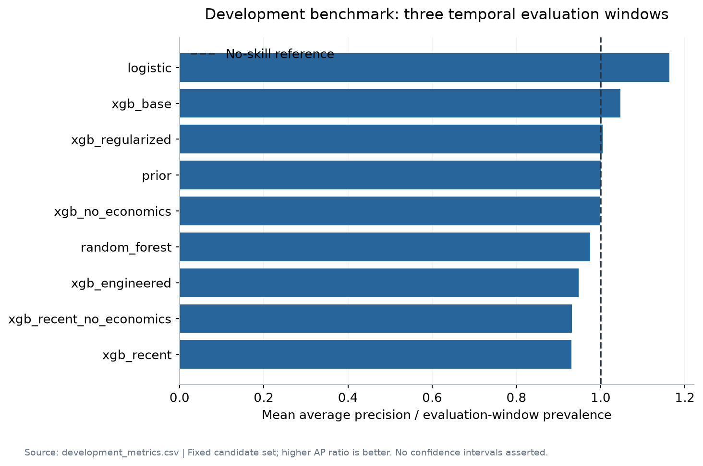

# Customer targeting under temporal distribution shift

A reproducible portfolio study comparing **nine model configurations across
three temporal backtests** on 41,188 banking records.



The study combines leakage controls, drift decomposition, model ablations,
probability calibration, contact-budget scenarios, SHAP diagnostics for the
original XGBoost model, and a local interactive demonstration.

**Finding:** logistic regression wins the declared development selection rule.
It reaches 0.643 ROC AUC and 1.37× retrospective lift at a 10% contact budget on
the existing final evaluation window. Performance is inconsistent across periods,
and calibration degrades under drift. These exploratory results do not support
operational deployment; the original test outcomes had already been inspected.

- [Project setup and methods](bank-marketing/README.md)
- [Full findings and experiment table](bank-marketing/results/FINDINGS.md)
- [Model card and limitations](bank-marketing/docs/MODEL_CARD.md)
- [Feature availability and experimental controls](bank-marketing/docs/FEATURE_AUDIT.md)
- [Resume and interview notes](bank-marketing/docs/RESUME.md)

```sh
cd bank-marketing
make setup
make reproduce
make test
make demo
```

Use Python 3.13 with the verified dependency lock. macOS requires
`brew install libomp`. Data comes from
[UCI Bank Marketing](https://archive.ics.uci.edu/dataset/222/bank+marketing)
under CC BY 4.0; full citations and dataset limitations appear in the project README.

Local verification: 15 unit/integration checks passed, including artifact
inference and demo interaction checks. GitHub Actions workflows are configured
for unit checks and manual reproduction; hosted execution has not been verified.
